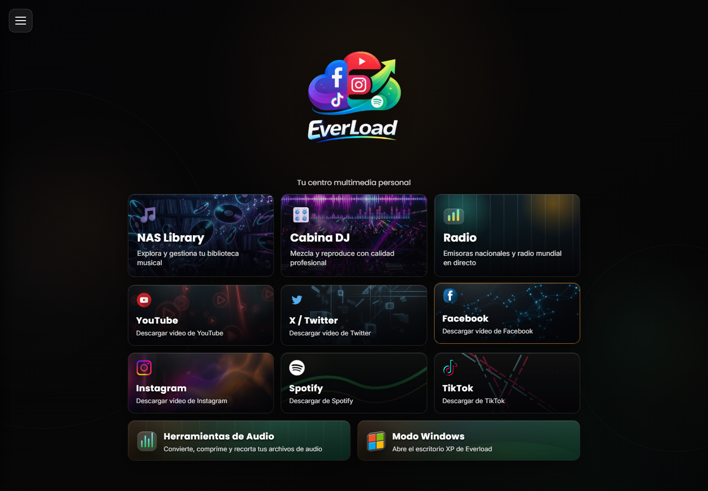
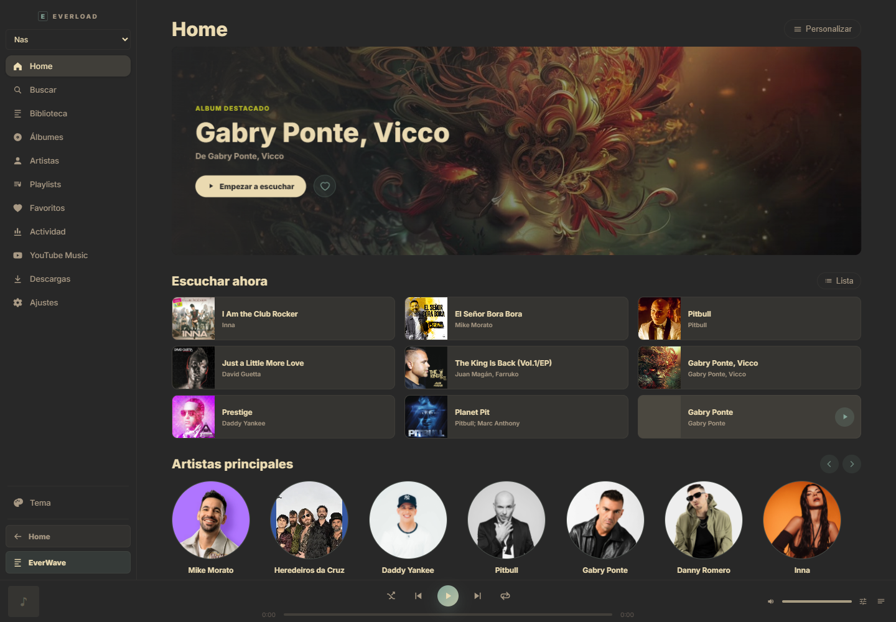

# EverLoad

Tu centro multimedia personal, alojado en tu propio servidor.

EverLoad combina biblioteca musical local o NAS, reproductores web, descargas
multimedia, radio, cabina DJ y herramientas de audio en una misma aplicacion.
Disponible en espanol, galego e ingles.

**Beta publica: `1.0.0-beta.1` | Plataforma: `linux/amd64` (Intel/AMD de 64 bits).**
No hay imagen ARM ni etiqueta `latest` en esta primera beta.
Usa datos de prueba y volumenes independientes, no tu unica copia de seguridad.



## Que incluye

- Asistente inicial: idioma, administrador con correo y configuracion opcional de biblioteca e integraciones. Sin credenciales por defecto.
- Biblioteca musical con artistas, albumes, playlists, favoritos y cola de reproduccion.
- Reproductores Modern y EverWave, ademas del escritorio de estilo Windows XP.
- Descargas de contenido compatible con yt-dlp y herramientas para convertir y recortar audio.
- Radio online, cabina DJ y chat entre usuarios.
- Panel de administracion, permisos de usuario y almacenamiento persistente.

Las funciones de servicios externos dependen de su disponibilidad, permisos y
claves. Las listas de Spotify se resuelven buscando contenido en YouTube; no se
descarga el audio directamente de Spotify. Utiliza contenido que tengas derecho
a descargar y respeta las condiciones de cada plataforma.

## Reproductor Modern



Capturas ilustrativas de una instancia configurada. La imagen Docker no incluye
canciones, cuentas, claves ni la biblioteca que aparece en las capturas.

## Instalacion rapida

Necesitas Docker y Docker Compose v2. Estos comandos son para Linux, macOS o WSL:
Ejecutalos solo para una instalacion nueva: no sobrescribas el `.env.beta` ni
regeneres el secreto JWT de una instalacion existente.

```sh
mkdir everload-beta
cd everload-beta
curl -fsSLo compose.beta.yml https://raw.githubusercontent.com/xianDT01/Everload/a35d71317af7d93cf6807dc306fd49240197c9bf/compose.beta.yml
umask 077
printf 'JWT_SECRET=%s\nEVERLOAD_IMAGE=xiandt/everload:1.0.0-beta.1\nEVERLOAD_PORT=8080\n' "$(openssl rand -base64 48)" > .env.beta
docker compose --env-file .env.beta -p everload-beta -f compose.beta.yml pull
docker compose --env-file .env.beta -p everload-beta -f compose.beta.yml up -d
```

Abre **http://localhost:8080**. Para obtener el codigo de instalacion de un solo uso:

```sh
docker compose --env-file .env.beta -p everload-beta -f compose.beta.yml exec everload cat /app/data/setup-code
```

El asistente permite crear el administrador y entrar en el menu principal aunque
no tengas NAS ni claves de Spotify, YouTube o AcoustID. Esos pasos son opcionales.
El codigo deja de ser valido al crear el administrador. No compartas el codigo,
el archivo `.env.beta` ni tus claves.

El puerto se vincula a `127.0.0.1` por defecto. Para acceso desde la red local,
consulta la guia completa; para Internet, usa HTTPS y un proxy inverso, no
expongas directamente esta beta.

## Biblioteca local o NAS opcional

La biblioteca inicial esta vacia y montada en solo lectura. Para probar con musica
propia, sustituye este montaje en `compose.beta.yml`:

```yaml
- beta-library:/app/nas_storage:ro
```

por una carpeta preparada del servidor, por ejemplo:

```yaml
- /srv/test-music:/app/nas_storage:ro
```

El proceso se ejecuta sin root, con UID/GID `10001:10001`. Esa cuenta necesita
permisos de lectura y acceso a la carpeta. El asistente selecciona subcarpetas
dentro de `/app/nas_storage`: escribir una ruta en la web no monta un NAS.

## Datos y actualizaciones

Compose conserva los datos, avatares y copias en volumenes independientes de la
biblioteca. Manten el mismo nombre de proyecto (`everload-beta`) al actualizar.
Haz una copia antes de cambiar de version. **No uses `docker compose down -v`**:
elimina los volumenes y sus datos. Una imagen antigua puede requerir restaurar
tambien su copia de la base de datos.

## Estado de la beta

La imagen publicada supero las pruebas de backend y frontend, la instalacion
desde cero y la persistencia despues de recrear el contenedor. El analisis Trivy
no dejo avisos HIGH/CRITICAL corregibles sin tratar; hay dos excepciones de Spring
MVC revisadas como no aplicables a las funciones actuales, con alcance limitado y
caducidad. Esto no significa que la aplicacion este libre de vulnerabilidades.

- [Guia completa de instalacion y actualizacion](https://github.com/xianDT01/Everload/blob/6c31cf2/docs/docker-beta.md)
- [Revision de seguridad de la beta](https://github.com/xianDT01/Everload/blob/6c31cf2/docs/security-beta.md)
- [Codigo fuente y documentacion del proyecto](https://github.com/xianDT01/Everload/tree/a35d71317af7d93cf6807dc306fd49240197c9bf)
- [Informar de un fallo](https://github.com/xianDT01/Everload/issues)

Al informar de un fallo, indica la version, navegador y pasos para reproducirlo.
No adjuntes bases de datos, contrasenas, claves API ni codigos de instalacion.
